# 🐳 Lanzamiento de cargas de trabajo dockerizadas con firma digital

> Práctica de la asignatura **Puesta en producción segura** 
> Instalación de **Docker** en Ubuntu 22.04 y firma / verificación de imágenes con **Notary v2 (Notation CLI)**.

## 🎯 Objetivo

Poder lanzar cargas de trabajo dockerizadas acompañadas de una **firma digital**, de forma que en cualquier momento se pueda **verificar que el contenido del contenedor no ha sido alterado** desde su entrega de código hasta su paso a producción.

## 🖥️ Entorno

| Elemento | Valor |
|---|---|
| SO | Ubuntu 22.04 LTS (VM) |
| Hostname | `validation-docker` |
| Usuario | `adminseguro` (con privilegios sudo) |

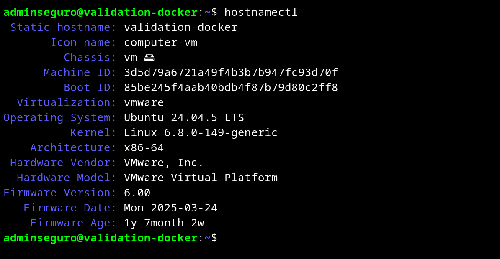

---

## 1️⃣ Instalación de Docker Engine

Siguiendo la guía: https://gcore.com/learning/how-to-install-docker-ubuntu/

### Actualización del sistema

```bash
sudo apt update && sudo apt upgrade -y
```

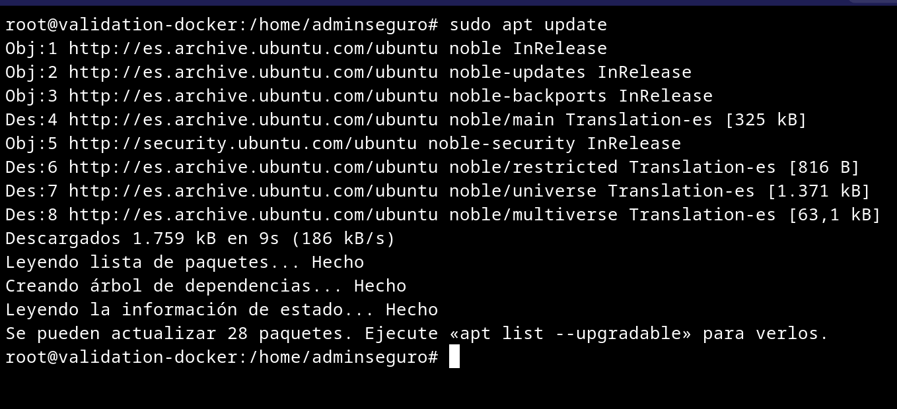

### Dependencias

```bash
sudo apt install -y ca-certificates curl gnupg
```

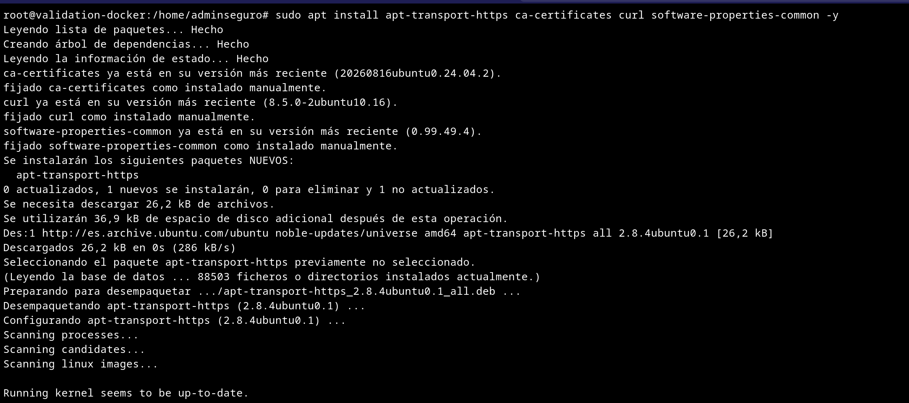

### Preparación del keyring GPG

> ⚠️ `apt-key` está obsoleto en Ubuntu moderno; se usa el directorio `/etc/apt/keyrings`.

```bash
sudo install -m 0755 -d /etc/apt/keyrings
curl -fsSL https://download.docker.com/linux/ubuntu/gpg | sudo gpg --dearmor -o /etc/apt/keyrings/docker.gpg
```

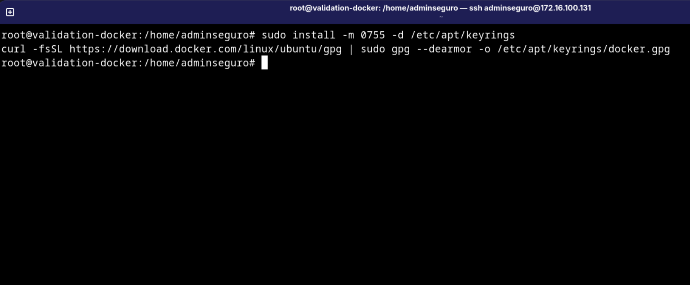

### Alta del repositorio oficial

```bash
echo "deb [arch=$(dpkg --print-architecture) signed-by=/etc/apt/keyrings/docker.gpg] https://download.docker.com/linux/ubuntu $(. /etc/os-release && echo $VERSION_CODENAME) stable" | sudo tee /etc/apt/sources.list.d/docker.list > /dev/null
```

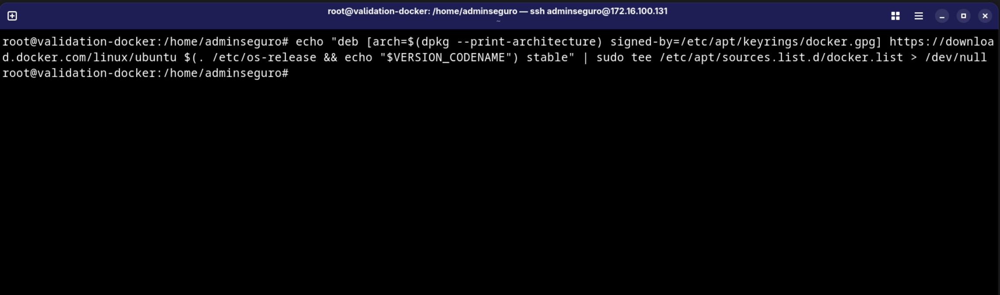

### Instalación

```bash
sudo apt update && sudo apt install -y docker-ce docker-ce-cli containerd.io docker-buildx-plugin docker-compose-plugin
```

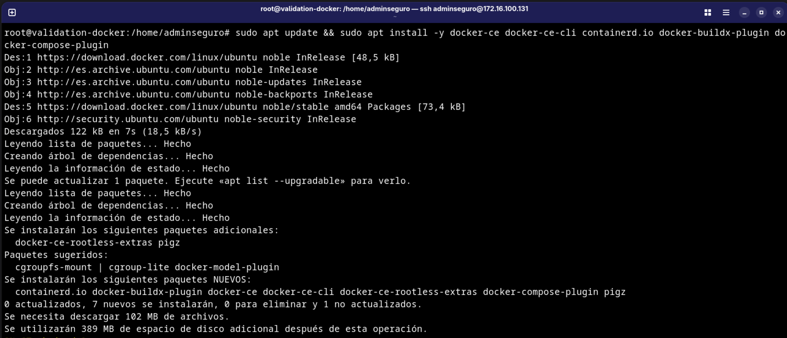

### Verificación

```bash
docker --version
sudo systemctl status docker
```

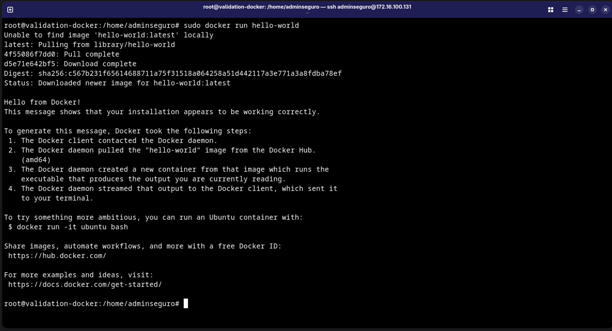

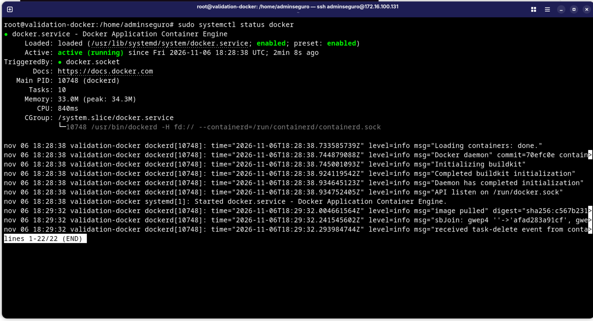

---

## 2️⃣ Construcción y publicación de la imagen

Aplicación de ejemplo: [net-monitor](https://github.com/wabbit-networks/net-monitor) (proyecto Notary v2) → `localhost:5000/net-monitor:v1`.

```bash
git clone https://github.com/wabbit-networks/net-monitor.git
cd net-monitor
docker build -t localhost:5000/net-monitor:v1 .
docker push localhost:5000/net-monitor:v1
```

> 🔧 **Troubleshooting:** la construcción directa con `docker build https://github.com/...` falla en BuildKit reciente con el error `failed to stat policy file Dockerfile.rego: invalid response status 404` (comprobación de políticas sobre el contexto remoto). Solución: clonar y construir desde el contexto local.

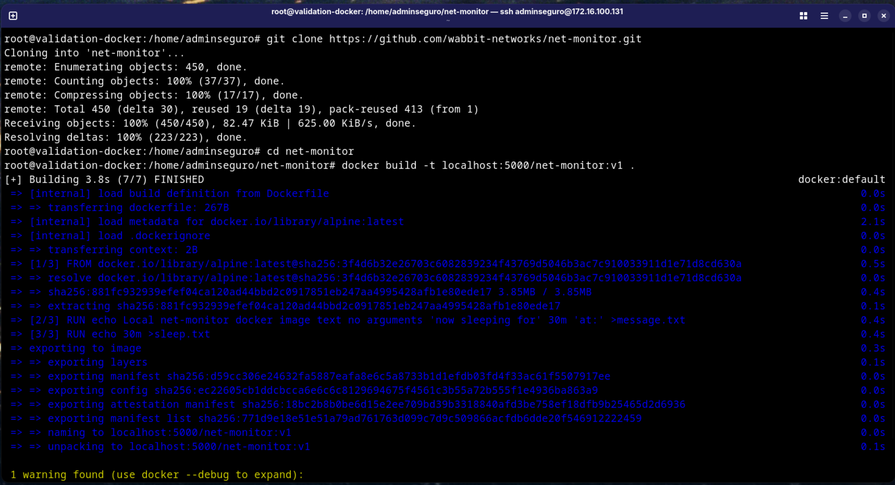
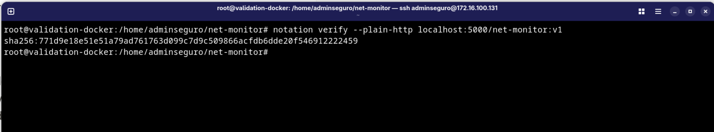
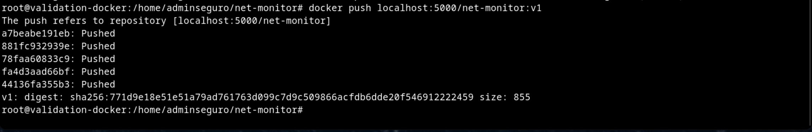

---

## 3️⃣ Instalación de Notation (Notary v2 CLI)

Siguiendo la guía: https://dev.to/azure/getting-started-with-notary-5eea

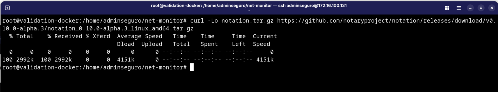
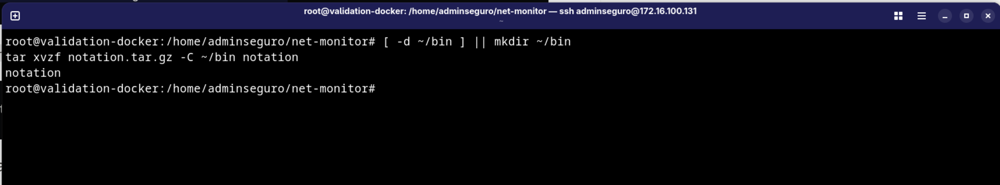
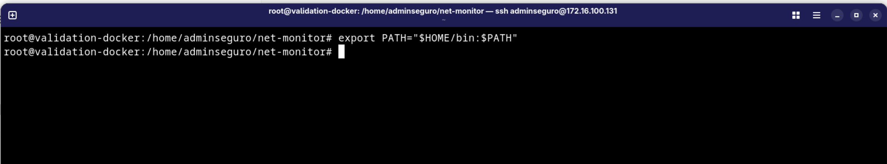

---

## 4️⃣ Firma digital de la imagen

### Certificado local de firma

```bash
notation certificate create --key "validation-key" --issuer "validation-certificate" --trust
```

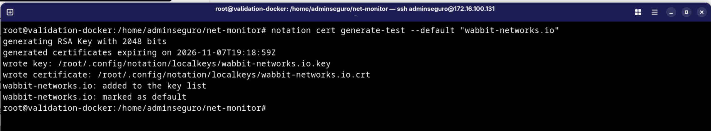

### Firma

```bash
notation sign --key "validation-key" localhost:5000/net-monitor:v1
```

Notation calcula el **digest** de la imagen (`sha256:...`) y publica la firma como un artefacto adjunto en el registry, enlazado a esa versión exacta del contenido.

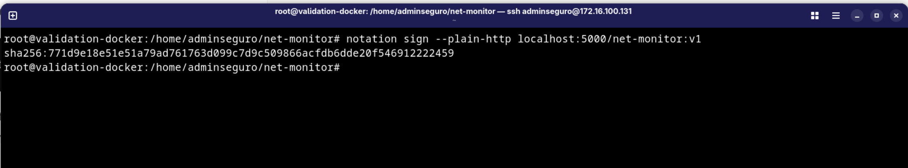

### Comprobación

```bash
notation list localhost:5000/net-monitor:v1
```

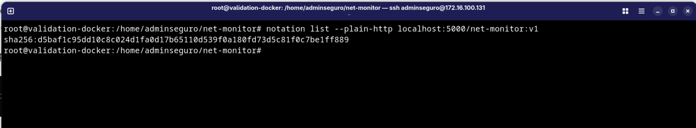

---

## 5️⃣ Verificación antes de producción

### Trust store (clave pública)

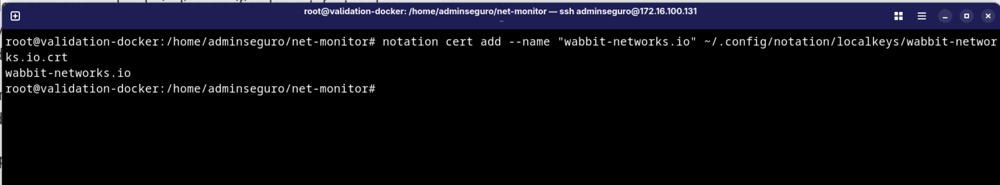

### Verificación

```bash
notation verify --key "validation-key" localhost:5000/net-monitor:v1
```

Si la imagen se altera tras la firma, el digest no coincide y la verificación **falla**, demostrando que el mecanismo detecta manipulaciones entre la entrega del código y la puesta en producción. ✅

---

## 📝 Conclusiones

- Docker permite empacar la aplicación y sus dependencias garantizando **portabilidad** entre entornos.
- El uso de repositorios oficiales y keyrings GPG evita los problemas del método obsoleto de `apt-key`.
- La firma con **Notation / Notary v2** aporta integridad y trazabilidad: la firma se enlaza al digest de la imagen y cualquier alteración la rompe.
- Combinar firma (entrega de código) + verificación (paso a producción) es un **control de seguridad real** para la *supply chain*.
- Dificultades encontradas: error `Dockerfile.rego` al construir desde URL remota (solucionado clonando), configuración del registry local como *insecure-registry* para el push.

## 📚 Referencias

- Guía instalación Docker: https://gcore.com/learning/how-to-install-docker-ubuntu/
- Guía Notation (Notary v2): https://dev.to/azure/getting-started-with-notary-5eea
- App de ejemplo: https://github.com/wabbit-networks/net-monitor
- Docker docs: https://docs.docker.com/engine/install/ubuntu/
- Notary (CNCF): https://github.com/notaryproject/notaryproject
